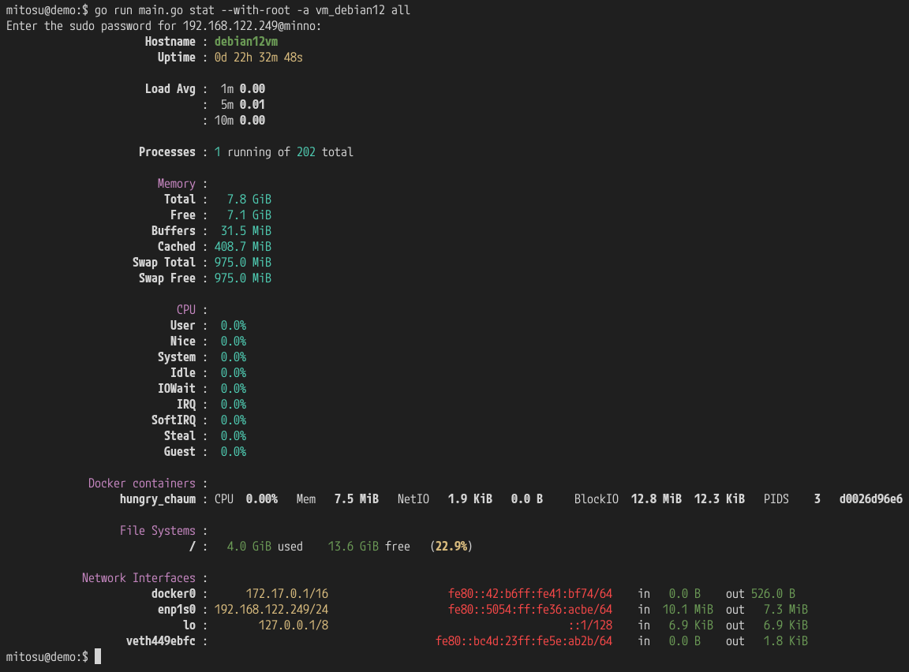

# mitosu

See into servers remotely over SSH.

`mitosu` is a remote system monitor inspired by [rtop](https://github.com/rapidloop/rtop).
It connects over SSH to a remote system and displays information (CPU, disk, memory, network, Docker containers).
No special software is needed on the remote system, other than an SSH server and working credentials.

Currently only Linux systems can be monitored, other system support is planned.

## Connecting

`--alias <name>` reads `~/.ssh/config` and `/etc/ssh/ssh_config` (or only
`--config FILE`, like `ssh -F`) the way `ssh <name>` does: `Host` blocks,
the first value wins, `Include` (relative to `~/.ssh`), tokens such as
`%h` and `${VAR}`. Used: `HostName`, `Port`, `User`, `IdentityFile`,
`IdentitiesOnly`, `UserKnownHostsFile`, `GlobalKnownHostsFile`,
`HostKeyAlias`. `Match` blocks with `all`, `host`, `originalhost`, `user`
and `localuser` are evaluated; other criteria (such as `exec`) are skipped
with a warning, and refused if the block would change where mitosu
connects. `ProxyJump` / `ProxyCommand` are refused. `--host` alone reads
no config. Flags given explicitly win over the config.

Without `--user` or a `User` line, mitosu logs in as your local user (it
used to default to `root`). Without `--key` or `IdentityFile`, it tries
OpenSSH's default keys (`~/.ssh/id_ed25519` and the others).

The server's host key must already be in `~/.ssh/known_hosts` (or the
files the config names, or `--known-hosts`). An unknown or changed key is
refused; mitosu never adds keys. To trust a new server, check its key and
connect once with `ssh`. Host certificates signed by a `@cert-authority`
entry are accepted.

Like OpenSSH, the identity files are offered first (through the ssh-agent
if it holds them), then the agent's other keys unless `IdentitiesOnly
yes`. A passphrase-protected key is unlocked with `--key-pass`, or with a
prompt only when the server accepts that key (for OpenSSH-format keys or
keys with a `.pub` file beside them); with `--no-prompt` a key that cannot
be unlocked is skipped.

Connecting gives up after 30 s. With `--no-prompt` the SSH handshake also
gives up after 30 s; otherwise it waits, since you may be typing a
password.

